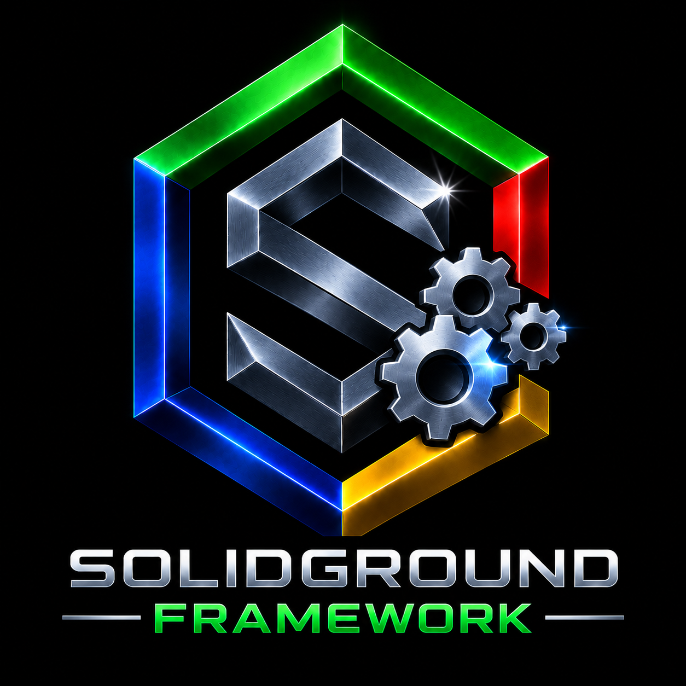

<table>
<tr>
<td width="290" align="center" valign="middle">
  
</td>
<td valign="middle">
  <h2>SolidGroundUX</h2>
  <h4>Version 2.2.2631102 R2 · © 2026 Testadura</h4>
</td>
</tr>
</table>

<table>
<tr>
<td width="33%" align="center">
  <a href="https://testadura-consultancy.github.io/SolidGroundUX/"><strong>Documentation</strong></a> 
  Product reference and guides
</td>
<td width="33%" align="center">
  <a href="CHANGELOG.md"><strong>Changelog</strong></a> 
  Releases and development history
</td>
<td width="33%" align="center">
  <a href="LICENSE"><strong>License</strong></a> 
  Terms of use and redistribution
</td>
</tr>
</table>

# SolidGroundUX 2.2 R2 Release Notes

## Consolidation, reliability and simpler installation

SolidGroundUX 2.2 R2 consolidates the substantial changes introduced in 2.2 and focuses on making the suite easier to install, update and maintain. The underlying product packaging and installation mechanisms remain intact; R2 improves how Setup identifies installed products, discovers available releases and lets the user choose what to install.

Version 2.2 introduced major Management Console capabilities for PostgreSQL, MariaDB and Web Content Management. It also replaced the former documentation-generation process with a Python implementation that can produce the complete documentation in seconds rather than the roughly 45 minutes previously required. R2 builds on that foundation with refinements to Setup, workspace deployment and on-demand documentation.

## Highlights of R2

### A simpler Setup workflow

Setup now presents a consolidated **Install / Update products** workflow. The available product overview distinguishes three independent sources of version information:

- **Installed:** The version reported by each installed product's definitions script.
- **Local:** The latest eligible release package in canonical storage, including archived packages.
- **GitHub:** The latest available release from the product's configured repository; newer versions are highlighted.

For each selected product, Setup offers the latest GitHub release, a specific GitHub release, the latest local release, an archived release or a ZIP from another filesystem location. The alternate-location selector accepts either a directory or a full ZIP path and defaults to the canonical release directory when left empty.

Multiple products can be installed or updated together, with one consolidated confirmation. **Remove products** likewise supports multiple selections while continuing to use the existing manifest-based removal mechanism. When several products are removed, Framework is processed last.

### Predictable configuration and bootstrap behavior

GitHub repository configuration uses packaged defaults with one optional local override, eliminating competing saved repository locations. Release lookup now uses more precise product-specific ZIP matching and clearer error reporting.

First Install retains its familiar workflow: extract the distribution ZIP, run `sgnd-setup.sh`, copy Setup and the included product packages to their canonical locations, then install the selected products from the supplied archives. A standalone Setup launched from elsewhere can also offer to copy itself to the canonical location, creating the directory if necessary.

Development target-root usage no longer inadvertently creates or loads machine-specific Setup state there, while normal installed-system state behavior remains available.

### Development and documentation refinements

The SDK's **Deploy Workspace** process excludes the private `release-manager.state` file, preventing it from breaking TAR-based deployment. Its completion dialog is now shown after errors as well as successful transfers, including a retry option on failure.

The Management Console adds on-demand documentation generation for installed products. It uses each product's installed release manifest to distinguish sources, generates Markdown, and can optionally render HTML using the existing Web Content Management pipeline. Obsolete prebuilt-documentation paths have been cleaned up.

Console menu actions without their own completion dialog now have a 30-second return delay. Existing explicit completion dialogs are retained.

## What remains from the original 2.2 release

- New PostgreSQL and MariaDB installation and configuration modules.
- Expanded Web Content Management and documentation publishing workflows.
- Python-based documentation generation supporting structured bundles, prefaces, epilogues, images, figure numbering and indexes.
- Further consistency across the console menus, interactive configuration flows, documentation comments and architecture diagrams.
- Framework interface refinements, including DataTable theme integration and library canonicalization improvements.

## Compatibility and installation

R2 keeps the existing release structure: a separate ZIP per product, each containing its TAR payload and integrity checks, plus a First Install ZIP containing Setup and the product ZIPs. No new installation engine or package format is introduced.

Local installation continues to work without GitHub availability. Updates, reinstalls and downgrades are handled by the existing installer after package selection and confirmation.

## Looking forward

PDF export is deferred to SolidGroundUX 3.0. For the 2.2 R2 line, the priority is a stable, reproducible installation and maintenance experience across the full suite.

**Make the difficult easy, without making the difficult impossible.**
